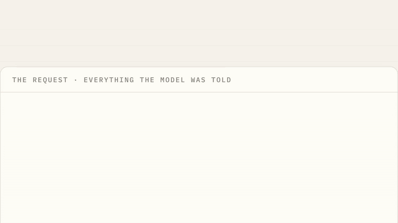
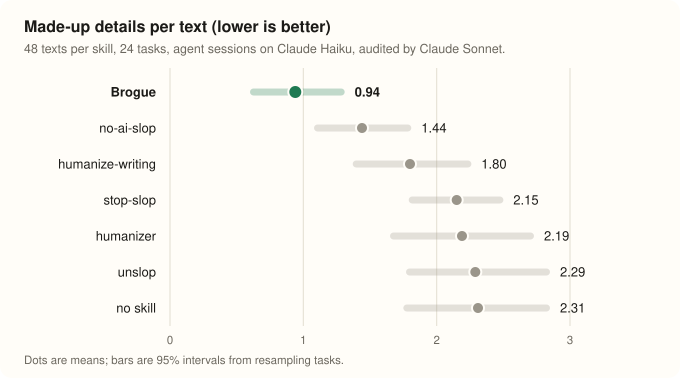

<div align="center">

# Brogue

**The writing skill that says only what you told it.**

AI drafts sound alive because the model fills the gaps: a feature you never shipped, a reason you never gave, a promise you never made.<br>Brogue writes for your reader, then checks every sentence against your request.

<br>

<table>
<tr>
<td align="center" width="25%"><h2>0.94</h2><sub>made-up details per text<br><b>with Brogue</b></sub></td>
<td align="center" width="25%"><h2>1.44</h2><sub>with the next best skill<br>(no-ai-slop)</sub></td>
<td align="center" width="25%"><h2>2.31</h2><sub>with no skill</sub></td>
<td align="center" width="25%"><h2>1.5×</h2><sub>fewer than the next best,<br>p = 0.011</sub></td>
</tr>
</table>



**[Live demo](https://kaifq1.github.io/brogue/)** · **[Benchmark](evals/README.md)** · **[The skill](skills/brogue/SKILL.md)** · [Film (MP4)](assets/brogue-film.mp4)

</div>

## Install

```bash
npx skills add KAIFQ1/brogue
```

Works in Claude Code, Codex, Cursor and any agent that reads `SKILL.md`. As a Claude Code plugin:

```text
/plugin marketplace add KAIFQ1/brogue
/plugin install brogue@brogue
```

Then ask in plain words:

```text
write the investor update: revenue $84k, up from $71k; two deals slipped; 14 months of runway
clean this up before I send it, it sounds like ChatGPT wrote it
write this for our India country head, he is very formal
```

## One request, two answers

The request: *"Write a Slack DM to Priya telling her I blocked PR #412 on payments-api because the scan found a live Stripe secret key hardcoded in config/billing.js. The key starts with sk_live_51 and was committed on Nov 14, so it must be treated as exposed and rotated today. I've already asked the Stripe admin, Marcus Lee, to roll it, and I need her team to move the key to the secrets manager and re-push by Thursday Nov 20."*

Both answers are recorded outputs from the same model in the same kind of agent session. Struck through: what an auditor found that the request never said.

<table>
<tr><th width="50%">No skill · 3 made up</th><th width="50%">Brogue · 0 made up</th></tr>
<tr>
<td valign="top">

Priya,<br><br>I've blocked PR #412 on payments-api. The secret scan flagged a live Stripe secret key hardcoded in config/billing.js. The key starts with sk_live_51 and has been in the repo since it was committed on Nov 14.<br><br>Treat that key as exposed. It needs to be rotated today. I've already asked Marcus Lee, our Stripe admin, to roll it.<br><br>Could your team do two things by Thursday, Nov 20:<br>1. Move the key into the secrets manager and ~~remove it from config/billing.js~~.<br>2. ~~Re-push the PR with the key read from the secrets manager at runtime.~~<br><br>~~I'm happy to pair on the change or review it once it's up.~~ Let me know if anything about the rotation or the secrets manager setup is unclear.<br><br>Thanks,<br>[Your name]

</td>
<td valign="top">

Hi Priya,<br><br>I've blocked PR #412 on payments-api. The scan found a live Stripe secret key (starts with sk_live_51) hardcoded in config/billing.js. It was committed on Nov 14, so we have to treat it as exposed and rotate it today. I've already asked Marcus Lee, our Stripe admin, to roll it.<br><br>Could your team move the key into the secrets manager and re-push by Nov 20?<br><br>Thanks

</td>
</tr>
</table>

## How it works

| | Step | What it prevents |
|---|---|---|
| **1** | **Find the reader.** Who reads it, what they do next, how they expect to be addressed, how they will use the page. | A blunt note to a senior client. Prose where an engineer wanted commands. |
| **2** | **Write from what you gave.** Every supplied fact goes in, plus what follows from them: the net of two figures, the decision they point to. Nothing about your situation that you did not supply. | The time-zone war story, the grateful customers, the "both are still active". |
| **3** | **Strike what you didn't say.** Each sentence is checked against the request. With a shell, the agent runs `scripts/ground.py`: a second model call that cuts unsupported statements and refuses any edit that adds or drops a number, link or quote. | Everything step 2 missed. A made-up detail reads as well as a true one, so no style rule catches it. |

Brogue also removes the machine patterns (the run-up, the staged contrast, the closing moral) and leaves a good human draft nearly untouched.

## Benchmark

Seven arms (no skill, Brogue and five open-source writing skills) wrote the same 24 workplace tasks in real Claude Code sessions, each with only its own skill installed, all on Claude Haiku. Tasks were generated from job roles in [agency-agents](https://github.com/msitarzewski/agency-agents), not written by hand, and this set was run once, after the skill was frozen. Claude Sonnet audited every text against its request.



| | Made-up details per text | 95% interval | Texts with none | Supplied facts left out |
|---|---|---|---|---|
| **Brogue** | **0.94** | **0.60 to 1.31** | **24 of 48** | **0.18** |
| no-ai-slop | 1.44 | 1.08 to 1.81 | 13 of 48 | 0.12 |
| humanize-writing | 1.80 | 1.37 to 2.26 | 11 of 46 | 0.05 |
| stop-slop | 2.15 | 1.79 to 2.50 | 8 of 48 | 0.05 |
| humanizer | 2.19 | 1.65 to 2.73 | 16 of 48 | 0.04 |
| unslop | 2.29 | 1.77 to 2.85 | 7 of 48 | 0.17 |
| no skill | 2.31 | 1.75 to 2.85 | 10 of 48 | 0.04 |

**Paired by task, Brogue made up less than every other skill**, by 0.50 to 1.38 details per text, p ≤ 0.011 in each comparison (sign-flip permutation test, tasks resampled).

**Where Brogue is not first: reader preference.** A model played each task's reader and chose blind between Brogue's text and another skill's. Brogue was chosen in 92 of 287 ballots (32%, 95% interval 27% to 38%). Against no skill it is level (21 of 48). It loses clearly to stop-slop and unslop (p < 0.05); against humanize-writing, humanizer, no-ai-slop it trails without a clear result. The simulated reader cannot tell which details are true, and it leans toward the fuller text: it chose the longer of the two in 167 of 278 ballots. Brogue gives up some of that appeal on purpose; closing the gap without adding invention is the next thing to improve. Per-skill results and the readers' reasons are in [`evals/`](evals/README.md).

**Measured honestly.** The auditor is a model and is noisy, so the texts of Brogue and the runner-up were audited a second time, independently: Brogue 0.83 against no-ai-slop 1.62 per text, so the gap held. Brogue ran its grounding script in 25 of 48 sessions; the rest it checked by hand. Readers and auditor are simulated. Every output, script and limit is in [`evals/`](evals/README.md), including the tuning rounds where Brogue lost.

## Compared with other writing skills

| | Brogue | Typical humanizer skill |
|---|---|---|
| Removes machine-writing patterns | ✓ | ✓ |
| Checks every sentence against the request | ✓ | – |
| Second-pass script that strikes unsupported statements | ✓ | – |
| Mechanical check on numbers, links and quotes | ✓ | – |
| Fits register to a named reader or region | ✓ | sometimes |
| Linter you can run in CI | ✓ | in one |
| Public benchmark against competing skills, with intervals | ✓ | – |

## The toolkit

The skill needs nothing but an agent. The Python package exposes the same steps for people who build with models. No dependencies.

```bash
pip install git+https://github.com/KAIFQ1/brogue
```

```bash
brogue write brief.md --persona corporate-uk   # write for a reader, then ground the result
brogue ground brief.md draft.md                # strike what the brief never said
brogue guard source.md rewrite.md              # did the rewrite keep every number, link and quote?
brogue lint draft.md --fail-at 30              # fail a CI job on dense machine patterns
brogue steer --persona corporate-uk            # a system-prompt fragment for any model
brogue profile my_writing.txt                  # a reader profile from a writing sample
brogue panel a.md b.md --jurors corporate-in,casual-us --deliberate
```

Commands that call a model use the `claude` CLI if it is installed, or any OpenAI-compatible endpoint through `BROGUE_BASE_URL`, `BROGUE_API_KEY` and `BROGUE_MODEL`.

```python
from brogue import ground, steer, load_persona

draft = my_model(steer(load_persona("support-empathetic")), request)
result = ground(request, draft, my_model)   # my_model: any function (system, user) -> text
print(result.text)      # the draft with unsupported statements removed
print(result.removed)   # what was struck
```

Eight reader presets ship as short TOML files: `neutral`, `corporate-us`, `corporate-uk`, `corporate-in`, `casual-us`, `casual-in`, `support-empathetic` and `technical-terse`. A persona sets register and conventions, never dialect: imitating a reader's speech reads as caricature to that reader.

## Limits

- English only, tested on workplace messages.
- 0.94 is low, not zero. Read anything that makes a claim about your product before you publish it.
- One writer model in the benchmark. Simulated readers. For a claim about real audiences, ask real people.
- No claim about AI detectors.

## Credits

Built after studying blader/humanizer, shir-danishyar/humanize, petergyang/no-ai-slop, hardikpandya/stop-slop, asavvin-pixel/unslop, anthropics/skills and obra/superpowers. Benchmark tasks are generated from msitarzewski/agency-agents; the comparison also runs in promptfoo. Details in [NOTICE.md](NOTICE.md). MIT licensed.
